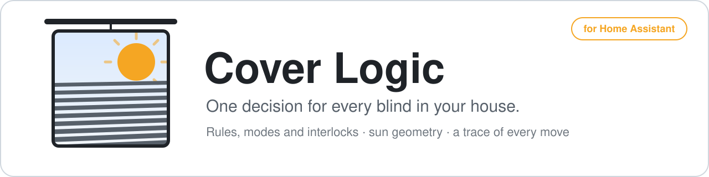
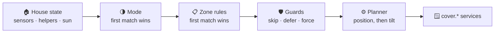

<p align="center">
  <picture>
    <source media="(prefers-color-scheme: dark)" srcset="docs/assets/banner-dark.svg">
    
  </picture>
</p>

<p align="center">
  <a href="https://hacs.xyz"></a>
  <a href="https://github.com/PeterLinuxOSS/ha-cover-logic/releases"></a>
  <a href="https://github.com/PeterLinuxOSS/ha-cover-logic/actions/workflows/test.yml"></a>
  
  <a href="LICENSE"></a>
  <a href="https://peterlinuxoss.github.io/ha-cover-logic"></a>
</p>

<p align="center">
  <b>Stop chasing "why did that blind just close?"</b><br>
  Describe your blinds, the modes your house can be in and the rules for each —<br>
  one engine decides where every blind should be, and tells you which rule decided it.
</p>

---

## How it decides



Every step is visible afterwards on `sensor.cover_logic_mode` — the active mode,
the rule each blind got, what is waiting on a guard, and the last command sent.

## Why Cover Logic

<table>
  <tr>
    <td width="33%" valign="top">
      <h3>🧭 One decision</h3>
      Modes and first-match rules replace a pile of automations that disagree about the same window.
    </td>
    <td width="33%" valign="top">
      <h3>🔍 A trace for every move</h3>
      Each blind names the exact rule that set it, so "why?" has an answer.
    </td>
    <td width="33%" valign="top">
      <h3>🧪 Shadow mode first</h3>
      <code>dry_run</code> is on by default: it decides and logs, and moves nothing until you say so.
    </td>
  </tr>
  <tr>
    <td valign="top">
      <h3>🛡️ Interlocks</h3>
      Guards skip, defer or force a blind — never lower it onto an open terrace door.
    </td>
    <td valign="top">
      <h3>☀️ Sun geometry</h3>
      Facade azimuth and tolerance decide when the sun hits a window; slat angle can be computed.
    </td>
    <td valign="top">
      <h3>✋ Respects people</h3>
      A manual move from the app is held until the decided target changes.
    </td>
  </tr>
</table>

## Quick start

1. **HACS → ⋮ → Custom repositories** → `https://github.com/PeterLinuxOSS/ha-cover-logic`, category **Integration**, then download **Cover Logic**.
2. Restart Home Assistant.
3. **Settings → Devices & Services → Add Integration → Cover Logic → Set up blinds now**: pick your covers, say which way each window faces, done.

It starts in [shadow mode](https://peterlinuxoss.github.io/ha-cover-logic/getting-started/shadow-mode/) —
watch what it would do, then turn `dry_run` off. Without HACS, copy
`custom_components/cover_logic/` into your `custom_components/` and restart.

<p align="center">
  <a href="https://peterlinuxoss.github.io/ha-cover-logic"></a>
</p>

## Compared with

|  | Cover Logic | [adaptive-cover](https://github.com/basbruss/adaptive-cover) | Hand-written automations |
|---|---|---|---|
| Scope | A whole house, zones and modes in one entry | One instance per window or group | One automation per idea |
| Decision | First-match rules, YAML or UI | Fixed sun-position algorithm | Whatever you wrote |
| Interlocks (doors, wind, sauna) | Built in (`guards:`) | None built in | Up to you |
| Dry run | Shadow mode by default | None documented | No |
| "Why did it move?" | Trace names the rule | No decision trace | Read the traces of each automation |
| Setting up one window | More to configure | Simplest | Simple |

adaptive-cover is the better fit for shading one window out of the box; Cover
Logic is built for deciding every cover in the house from one set of rules.

## For developers

[`MODELS.md`](MODELS.md) is the technical brief and [`docs/rationale.md`](docs/rationale.md)
the design-decision ledger. [`docs/example-config.yaml`](docs/example-config.yaml)
is a complete example; `fixtures/dom_peter.yaml` is the author's real house and
the migration fixture — do not copy from it.

```bash
python3 -m pytest tests/ -q              # decision core, any Python >= 3.12
.venv/bin/python -m pytest tests/ -q     # + Home Assistant layer, Python >= 3.14.2
ruff check . && ruff format --check .
```

`tests/parity/` compares the engine with a real house's Jinja template across
92,160 scenarios; those files are not in this repository, so it cannot run in
CI — run it locally before trusting a change to the decision logic.
`MODELS.md` §8 explains what each interpreter exercises.

## License

MIT — see [`LICENSE`](LICENSE).
