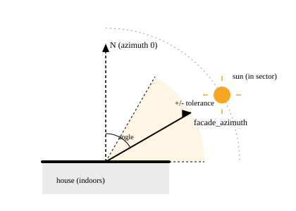

# Blinds

A blind is one physical `cover.*` entity: the thing the engine decides a
position and tilt for. Everything else in the config — zones, rules, guards —
refers to blinds by their `entity`, never by a second id of their own.

```yaml title="config"
blinds:
  - entity: cover.living_room_balcony
    facade_azimuth: 180 # south -- 0 is north, measured clockwise
    tolerance: 40 # sun counts as "on this facade" from 140 to 220 degrees
    travel_time: 45 # seconds for a full run, top to bottom
  - entity: cover.kitchen_window
    has_tilt: false # roller blind, no slat axis at all
zones:
  living_room:
    members: [cover.living_room_balcony]
  kitchen:
    members: [cover.kitchen_window]
modes:
  - id: home
rules: {}
```

## Azimuth and the tolerance cone

`facade_azimuth` is the compass bearing the window's *outside* faces, in
degrees, 0 to 360, measured clockwise from north — the same convention a
compass rose is drawn in: 0 is north, 90 is east, 180 is south, 270 is west.
`tolerance` (default 45°) is how far either side of that bearing still counts
as "the sun is on this facade", for the `sun_hits_target` condition. The
sector is half-open — `[facade_azimuth - tolerance, facade_azimuth +
tolerance)` — so a sun azimuth of exactly `facade_azimuth + tolerance` is just
outside it.



A blind with no fixed orientation can omit `facade_azimuth` entirely, at the
cost of `sun_hits_target` never matching it.

!!! warning "A round 90/180/270 is a placeholder, not a measurement"
    A perfectly round azimuth is a strong signal nobody actually measured the
    wall — most houses are not built square to the compass. Measure it
    instead of guessing:

    1. Open a satellite view of the house (any map app with aerial imagery)
       and draw a line straight out from the window, perpendicular to the
       wall.
    2. Read the bearing of that line off the map's north arrow, or drop the
       two endpoints into a bearing calculator.
    3. Cross-check with a compass app held flat against the glass, facing
       outward — the two should agree within a few degrees.

    A wrong azimuth does not fail loudly: `sun_hits_target` will simply be
    true or false at the wrong times of day, and nothing else about the
    configuration looks broken.

## Travel time and why tilt waits for arrival

`travel_time` (default 60s) is how long a full run takes, used to wait for
the position move to finish before sending a tilt command. This matters
because a tilt sent *during* a position move is typically discarded by the
motor — the blind arrives at the right height with slats in whatever state
they happened to be in. `tilt_after_arrival` (default `true`) is what turns
this waiting on; set it to `false` only if your motor genuinely accepts both
commands at once. Get `travel_time` roughly right — a blind that physically
takes 55s to close should not be configured with 20s, or the tilt command
fires while it is still moving.

## `has_tilt`

`has_tilt` (default `true`) marks whether the cover has a slat/tilt channel
at all. A blind with `has_tilt: false` — a roller blind — should only ever be
given a `position` in its rules; the engine still accepts `tilt` values for
it, but nothing is ever sent for that axis.

## Common mistakes

- Leaving `facade_azimuth` at a round placeholder instead of measuring it.
- Setting `travel_time` far below the blind's real full-travel time, so tilt
  commands race the position move.
- Forgetting `has_tilt: false` on a roller blind, which does not break
  anything by itself but makes a `tilt` value in a rule misleading to read.

## Where to edit this

**Settings → Devices & services → Cover Logic → Add blind** (or **Edit
blind**, from the options menu). The form matches this schema field for
field, including `slat_distance`/`slat_depth` for a computed
[slat angle](values.md).

See the [reference: blinds](../reference/configuration.md#blinds) for every
field and its default.
