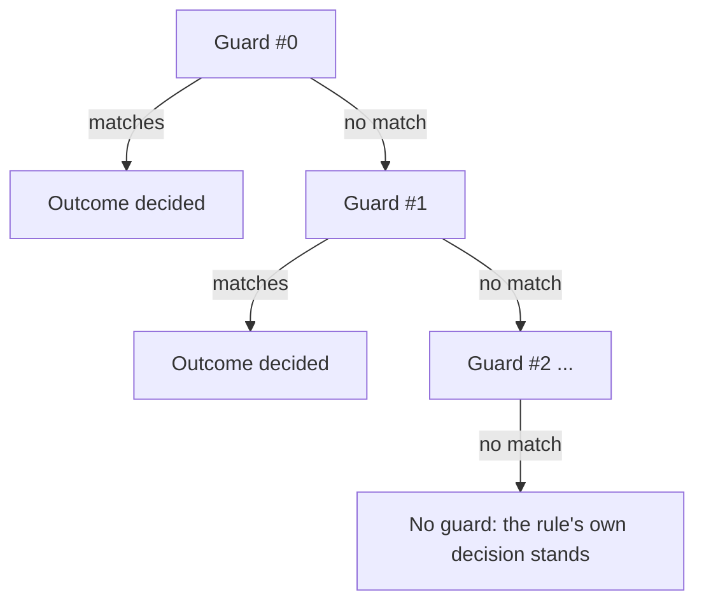

# Guards

A guard is a safety interlock: a condition, a policy, and what it covers —
evaluated on top of whatever the rules decided. `guards` is an ordered list;
like modes and rules, they resolve **first match wins**, in written order.
There are no numeric priorities.

```yaml title="config"
blinds:
  - entity: cover.living_room_balcony
zones:
  living_room:
    members: [cover.living_room_balcony]
modes:
  - id: home
conditions:
  balcony_door_open:
    condition: state
    entity_id: binary_sensor.balcony_door
    state: "on"
rules:
  home.living_room:
    - then: {position: 0, tilt: 0}
guards:
  - name: do not lower the balcony blind while the door is open
    policy: defer
    applies_to: closing # raising it is always safe; only closing is the hazard
    targets: [living_room]
    when: !ref balcony_door_open
    max_wait: 10800
    on_timeout: abandon
    recheck_every: 900
```

While the door is open, a close the rule decided is held back; once the door
shuts the guard stops matching and the rule's close is sent on that same
recompute. One `defer` guard is the whole interlock — see
[door interlock](../how-to/door-interlock.md) for the recipe.

First match wins **per blind**: for each blind, the first guard (in written
order) whose targets cover it, whose `applies_to` matches and whose `when` is
true decides that blind, and no later guard is asked. Two guards with the
same `when` and overlapping targets therefore never both fire — the second
is dead for those blinds.

## Policies

- **`skip`** — do not move it. The matched axis' whole action is suppressed,
  tilt included, not just the half the condition is about.
- **`defer`** — move it later. Requires `max_wait` (`null` means wait
  indefinitely — a stated value, not an omission) and `on_timeout`
  (`proceed`: do it anyway once the wait runs out, or `abandon`: drop it —
  no default, since the two are opposites and both are in real use).
- **`force`** — move it now, regardless of what the rules decided. Requires
  `then:`, the action to impose.



## Stage: before or after the decision

`stage: output` (the default) judges the action the rules already decided —
it can still see what the engine chose. `stage: input` drops the target
*before* the engine is even asked, so no decision is made for it at all. An
`input`-stage guard may not set `applies_to` to anything but `any`: at that
point there is no candidate command yet for "closing" or "opening" to mean
anything about.

## `applies_to`

`closing` means a **decreasing position**, and only that — a blind's slats
moving are never by themselves the hazard a guard like this exists for.
`opening` is the increasing case; `any` (the default) does not care which
way.

## A numeric threshold needs a named condition

When editing from the UI, a guard's own inline condition selector cannot
carry the `default` a `numeric_state` needs — Home Assistant's selector
rejects that key — so a guard gated on a numeric threshold must reference a
named [condition](../reference/conditions.md#named-conditions-and-ref) instead.

## `max_wait`, `on_timeout`, `recheck_every`

These three only apply to `defer`. `max_wait` is how long the wait may last
(seconds, or `null` for no deadline); `on_timeout` is what happens when it
runs out — `proceed` sends the held action, `abandon` logs a warning and
sends nothing. Either way the guard keeps holding the blind for as long as
its condition stays true, and releases it the moment the condition clears.

A wait survives a Home Assistant restart without a hand-written watchdog
because it is not an in-flight timer: it is re-derived from the
configuration and the live condition on every evaluation, so the first
evaluation after startup recreates it (with `waited` back at zero, which
only ever makes a timeout later). `recheck_every` (seconds, default 900)
is how often an unresolved wait is re-examined even when nothing else
changes, and the re-examination is never scheduled past the `max_wait`
deadline, so the timeout applies on time.

## Common mistakes

- Writing a `defer` without deciding `on_timeout` up front — there is no
  default, and the two choices behave oppositely.
- Putting a narrower guard after a broader one that already matches
  everything it would have covered — first match wins, so the narrower one
  never gets a turn. A `skip` and a `defer` with the same `when` on the same
  blind are the common case: only the first one written ever fires.
- Giving an `input`-stage guard a direction other than `any` — this is a
  configuration error, not a silent no-op.

## Where to edit this

**Settings → Devices & services → Cover Logic → Add guard**. The first
screen asks for `policy` before anything else, because the policy decides
which fields the next screen even shows.

See the [reference: guards](../reference/configuration.md#guards) for the
full field list.
