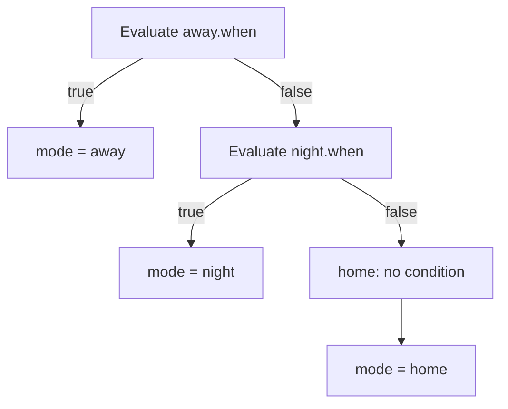

# Modes

A mode is the house's overall state — `away`, `night`, `home`, and so on.
Exactly one mode is active at a time, and which rules apply depends on the
active mode as well as the zone (see [rules](rules.md)).

```yaml title="config"
blinds: []
zones: {}
conditions:
  house_armed_away:
    condition: state
    entity_id: alarm_control_panel.home_alarm
    state: armed_away
  house_dark:
    condition: sun
    after: sunset
    before: sunrise # before+after sunrise/sunset is the dark window around midnight
modes:
  - id: away
    when: !ref house_armed_away
  - id: night
    when: !ref house_dark
  - id: home # fallback: no `when` at all, and it must be last
rules: {}
```

## First match wins

`modes` is an ordered list. Each mode's `when` is evaluated top to bottom,
and the **first** one whose condition matches is the active mode — later
modes are never even checked, so order encodes priority. `away` is listed
first above because being armed away should outrank being in the dark
window, not the other way round.



## The last mode has no condition

The last entry in `modes` must omit `when` entirely — it is the fallback,
guaranteed to match whatever the earlier modes did not. `validate()` flags
this as an error two ways: `no_fallback_mode` if nothing in the list is
condition-less, and `fallback_mode_not_last` if one exists but something
follows it (which could then never run). Choosing no mode at all is not a
valid outcome for a configuration — leaving a true fallback off the end is
the one requirement every list of modes must satisfy.

A `when` condition can be any of the dialect's bodies — `state`,
`numeric_state`, `time`, `sun`, `template`, `and`/`or`/`not`, or a reusable
`!ref`. The diagram below is what a `sun`-based condition like `house_dark`
actually divides a day into: everything before dawn and after dusk falls
into one segment, the rest into another.


A top-level `numeric_state` also takes a `default`, used when the compared
entity is unavailable or not a number — pick one that fails on the safe
side, since the condition is evaluated exactly as if that were the entity's
real reading.

## Common mistakes

- Putting the fallback mode anywhere but last.
- Giving two modes overlapping conditions and relying on list order to
  break the tie without checking which one is actually listed first.
- Forgetting that a mode id may not contain a `.` — it is joined with the
  zone id as `f"{mode}.{zone}"` to look up rules, and a dot would make that
  join ambiguous.

## Where to edit this

**Settings → Devices & services → Cover Logic → Add mode** (or **Edit
mode**). The options menu also has a read-only report of modes and rules in
their real evaluation order, useful for checking first-match-wins ordering
without reading YAML.

See the [reference: modes](../reference/configuration.md#modes) for the
field list.
