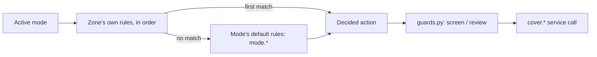

# Rules

A rule says what a zone's blinds should do, in one mode. `rules` is a mapping
keyed `"<mode id>.<zone id>"`, each value a list of rules evaluated
first-match-wins — the same resolution order as modes themselves.

```yaml title="config"
blinds:
  - entity: cover.a
    facade_azimuth: 270
zones:
  terrace:
    members: [cover.a]
modes:
  - {id: night, when: {condition: state, entity_id: input_boolean.cover_down, state: "on"}}
  - {id: home}
values:
  flower_target:
    entity: input_number.flower_position
    default: 34
rules:
  night.terrace:
    - then: {position: 0, tilt: 0}
  home.terrace:
    - if: {condition: numeric_state, entity_id: sensor.wind, default: 0, above: 60}
      then: {position: 100, tilt: 100}
      name: high wind, open fully
    - then: {position: !ref flower_target, tilt: keep}
```

## First match, in order

For the resolved mode and each zone, the key `f"{mode}.{zone_id}"` is looked
up and its rule list is tried top to bottom; the first rule whose `if`
matches decides that zone's blinds. A rule with no `if` matches
unconditionally, so it should always be last in its list — anything after it
can never fire. No matching rule at all (or no `rules:` entry for that key)
both resolve to "keep both axes", shown in the trace as `#none` — the two
causes look the same on purpose, since debugging either means checking the
same things.



## `then`: `keep` or a number, per axis

`then` is `{position?, tilt?}`. Each axis is independently:

- an integer `0`–`100`,
- `keep`, meaning leave that axis exactly where it is, or
- `!ref <value name>`, read at decision time (see [values](values.md)).

Leaving an axis out of `then` entirely means the same as `keep` — a rule
`then: {position: 100}` for a blind with no tilt axis is written exactly
like that, nothing else needed.

## Inherited defaults

A rule list filed under the special zone id `*` — `"<mode id>.*"` — applies
to **every** zone in that mode that does not shadow it. A zone's own list is
tried in full first; only once nothing in it matches does evaluation fall
through to the mode's defaults, also tried in full. This lets a house say
"everyone closes at night" once instead of repeating the same rule per zone,
while still letting one zone override it with its own list.

```yaml
# fragment -- "*" is every zone in mode "night" that has no own rules for it
rules:
  "night.*":
    - then: {position: 0, tilt: 0}
```

## `events`

`events` restricts a rule to specific triggering events (for example
`arrival`, fired when someone's `person.*` state changes and they occupy the
zone — see [zones](zones.md#fields)). If the event that triggered this
evaluation is not in the list, the rule is skipped regardless of its `if` —
useful for a rule that should only fire the moment someone gets home, not on
every later recompute while they stay home.

## Common mistakes

- Placing a condition-less rule before one that should take priority — it
  will always win, and the rules after it never run.
- Forgetting that `"*"` default rules only apply when a zone's **own** list
  has no match at all, not as a merge with it.
- Using `events:` to try to limit *how often* a rule can fire over time — it
  only filters by which kind of event triggered this evaluation, not by
  timing.

## Where to edit this

**Settings → Devices & services → Cover Logic → Add rule** (or **Edit
rule**), after choosing the mode and zone it belongs to. Its `order` field
stands in for YAML list position — lower runs first, suggested ten past the
last rule in that list so there is room to insert one later; no two rules in
the same mode-and-zone list may share an order. The options menu's "rules in
real evaluation order" report shows the full first-match-wins sequence, own
rules before defaults, without reading YAML.

See the [reference: rules](../reference/configuration.md#rules) and
[reference: rule `then`](../reference/configuration.md#rule-then) for the
full field list.
