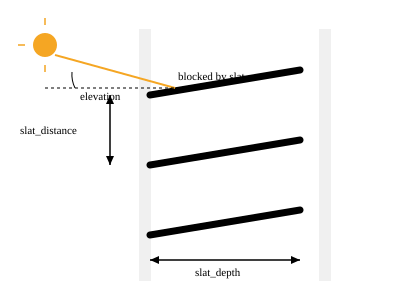

# Values

A value is something a rule's `position`/`tilt` can read instead of a literal
number, referenced with `!ref <name>`. `values` is a mapping of
`name -> body`; `type` (default `entity`) picks which of the two shapes it
is.

```yaml title="config"
blinds:
  - entity: cover.a
    facade_azimuth: 270
    slat_distance: 25 # mm, gap between adjacent slats
    slat_depth: 35 # mm, width of one slat, front to back
zones:
  terrace:
    members: [cover.a]
modes:
  - id: home
values:
  flower_target: # type: entity (the default) -- read a helper at decision time
    entity: input_number.flower_position
    default: 34
  slat_angle: # type: slat_angle -- computed from solar geometry
    type: slat_angle
    default: 50 # used whenever the geometry has no answer
    scale: half
rules:
  home.terrace:
    - then: {position: !ref flower_target, tilt: !ref slat_angle}
```

## `type: entity`

Reads a Home Assistant helper at decision time, truncated to an integer —
**not** clamped to 0–100, unlike a literal in a rule. `default` is required
and is what a rule gets back when the entity is missing or unparsable; it is
itself range-checked at parse time.

## `type: slat_angle`

Computes the tilt percentage that just blocks the direct sun beam, using the
**blind being decided**'s own `facade_azimuth`, `slat_distance` and
`slat_depth` — one `slat_angle` value serves every facade in the house, each
blind supplying its own geometry. `scale: half` (the default) maps 0–90° of
slat rotation to 0–100%; `scale: full` maps the full 0–180°.



`default` here is returned whenever the geometry has no answer at all — the
sun is down, off this facade, the blind states no `slat_distance`/
`slat_depth`, or the slats cannot block the beam at that elevation — never an
error, always the stated fallback. Unlike an `entity` value, the computed
result **is** clamped to 0–100 before it reaches the rule, because degrees
past the slat's own travel are not a position the hardware has.

!!! warning "The slat direction is unverified"
    The formula gives a *high* percentage for a *high* sun. Whether `tilt:
    100` means "slats flat/open" or "slats steep/closed" depends on your
    motor's own convention, and that mapping has not been confirmed against
    real hardware in practice. Before relying on `slat_angle` for anything,
    test it on one blind: set a rule to `tilt: !ref slat_angle`, watch what
    the slats actually do as the sun moves, and only then roll it out to
    the rest of the house. Measure `slat_distance`/`slat_depth` on the blind
    itself, once per slat type — not guessed.

## Common mistakes

- Using `type: entity` without a sane `default` — a helper that resets to 0
  after a restart (no `initial:`) will silently drive every rule that reads
  it until someone notices.
- Expecting `slat_angle` to also decide height — it never does; see
  [rules](rules.md) for position, which `slat_angle` leaves alone.
- Rolling `slat_angle` out to every facade before confirming the tilt
  direction on one blind (see the warning above).

## Where to edit this

**Settings → Devices & services → Cover Logic → Add value** (or **Edit
value**). `scale` only appears once `type: slat_angle` is selected — the
form adapts to the chosen type.

See the [reference: values (entity)](../reference/configuration.md#values-entity)
and [reference: values (type: slat_angle)](../reference/configuration.md#values-type-slat_angle)
for the full field list.
