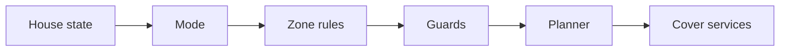

# Cover Logic

Most blind automations are a pile of "if this, then that" rules, and they work
until the day two of them disagree about the same window. Cover Logic replaces
that pile with a single decision: you describe your blinds, the modes your house
can be in, and the rules for each — and one engine decides where every blind
should be, every time, with a record of which rule decided it and why. Because
the decision is data rather than scattered automations, you can read it, test
it, and move it to a different house. If you have ever lost an afternoon to
"why did that blind just close?", this is aimed squarely at you.

It is a Home Assistant custom integration. Nothing is stored outside your
Home Assistant instance and nothing leaves it.

## How a decision gets made

[House state](concepts/blinds.md) (sensors, helpers, the sun) decides the
active [mode](concepts/modes.md); the mode and each [zone](concepts/zones.md)
together pick a list of [rules](concepts/rules.md), first match wins; the
result passes through [guards](concepts/guards.md), the interlocks that can
drop or delay a blind for reasons that are not really decisions — an open
door, a storm, a sauna still running; what survives goes to the planner,
which turns one target position and tilt into the ordered `cover.*` service
calls a real motor needs. Every step of that chain is visible afterwards on
[`sensor.cover_logic_mode`](reference/sensor.md), including the planner's
own output as [`last_command`](reference/sensor.md#last_command).

## What makes it different

|  | Cover Logic | [adaptive-cover](https://github.com/basbruss/adaptive-cover) |
|---|---|---|
| Scope | Several zones and modes for a whole house in one config entry | One instance per window or cover group |
| Decision | First-match rules you write, in plain YAML or the UI | A fixed sun-position algorithm per cover type |
| Safety interlocks | `guards:` — skip, defer or force a blind for doors, wind, a running sauna | None built in |
| Rollout | Shadow mode: decides and logs, moves nothing until you flip `dry_run` off | No dry-run mode documented |
| Why did it do that? | `sensor.cover_logic_mode`'s `trace` names the exact rule | No decision trace among its entities |
| Noisy sensors | A `numeric_state` condition can debounce with `for:` and latch the result for the day | Fixed delta-position/delta-time throttling |
| Setting up one window | More to configure | Simpler — built for exactly this |
| What you can see | One diagnostic sensor | A target-position sensor, sun start/end times, a "sun in front of window" binary sensor, and more, per instance |

adaptive-cover is the better fit for "decide one window's shading
automatically" out of the box; Cover Logic is built for "decide every cover
in the house from one set of rules, and know why it decided that."

## Where to go next

- New install: [install](getting-started/install.md) →
  [first setup](getting-started/first-setup.md) →
  [shadow mode](getting-started/shadow-mode.md).
- Coming from a hand-written automation or another cover integration: the
  [migrate](how-to/migrate.md) how-to.
- Understand the model before writing rules: [concepts](concepts/blinds.md).
- Something did not move the way you expected: [troubleshooting](troubleshooting.md).
